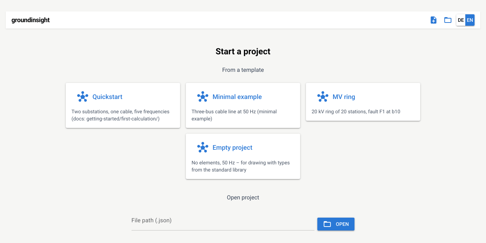
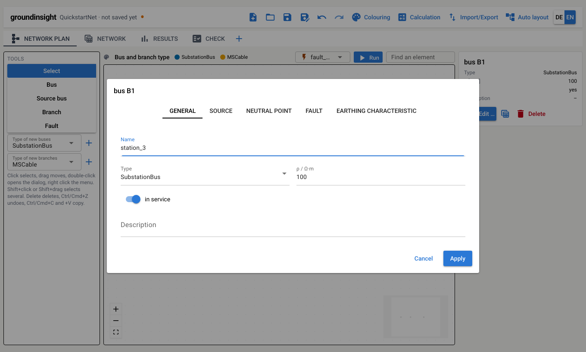
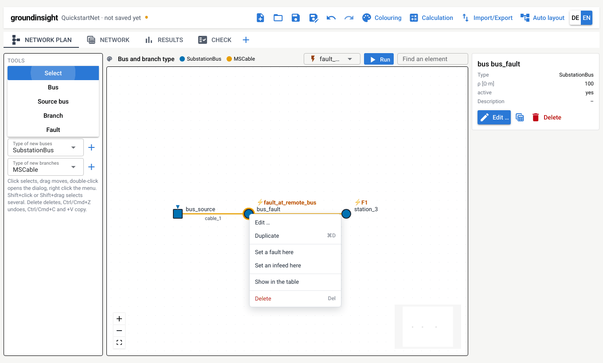
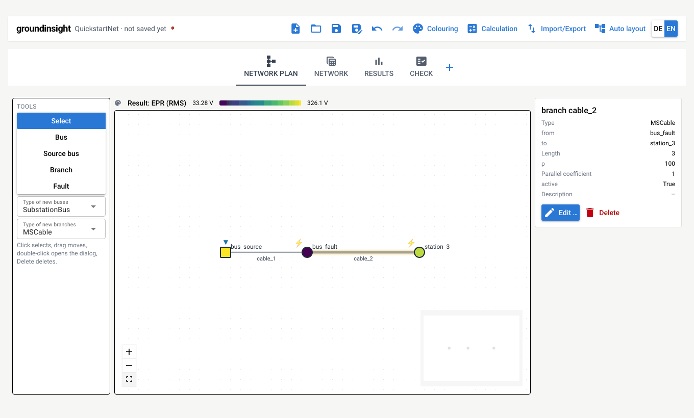
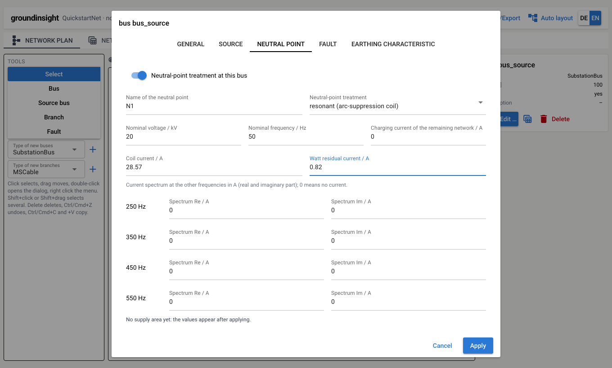

# Draw and solve a network

This tutorial uses `groundinsight-gui`, the front end of the library: you draw
a network on a canvas, solve a fault and read the results, without writing
code. It starts from the network of [Your first fault calculation](first-calculation.md)
— two substations and a 5 km cable — and adds a third station behind a 3 km
cable. At the end the same network is built with the library, and both give
the same numbers.

## Install and start

The GUI is a distribution of its own, `groundinsight-gui`, in the library's
repository. It is not on PyPI yet; install it together with the library from
a checkout, so that both have the same version:

```bash
git clone https://github.com/Ce1ectric/groundinsight.git
cd groundinsight
python -m venv .venv
source .venv/bin/activate      # Windows: .venv\Scripts\activate
pip install . ./gui
python -m groundinsight_gui --lang en
```

The last command opens `http://127.0.0.1:8080` in the browser
(`--native` opens a desktop window instead, after `pip install "./gui[native]"`;
`--help` lists all options). The server listens on your machine only.

## 1. Start from a template



Click **Quickstart**. The template is the network of the first tutorial:
`bus_source` with the infeed (the blue triangle), `bus_fault` with the fault
`fault_at_remote_bus` (the flash) and `cable_1` between them, at 50, 250, 350,
450 and 550 Hz. The *Network plan* tab shows it; *Network* holds the same
network as editable tables, and a change in one shows in the other.

## 2. Draw a station and a cable

In the **Tools** palette on the left:

1. Choose **Bus**, keep *Type of new buses* at `SubstationBus`, and click into
   the canvas to the right of `bus_fault`. A bus `B1` appears.
2. Choose **Branch**, keep *Type of new branches* at `MSCable`, and drag from
   `bus_fault` to `B1`. A 1 km cable `L1` connects them.
3. Choose **Select** again (or press Esc). A click selects an element and
   shows it in the *Properties* panel on the right; dragging moves a symbol
   on the raster.


Double-click `B1`. In the dialog, set *Name* to `station_3` and keep
ρ = 100 Ω·m; **Apply** (or Enter). Double-click the cable `L1`, set *Name* to
`cable_2` and *Length / km* to `3`; **Apply**. An entry that cannot be read —
text where a number belongs, a name that is taken — is marked at its field
and nothing is applied.



Every change is one step of the service layer: **Undo** and **Redo** in the
toolbar (Ctrl/Cmd+Z, Shift+Ctrl/Cmd+Z) take it back and forth, and a change
the library refuses — a negative length — is not applied and says why.

The plan is edited like a drawing:

- Shift (or Ctrl/Cmd) and a click add an element to the selection or take it
  away; Shift and a drag draw a frame around several. A selected group is
  moved by dragging one of its symbols and deleted with Delete — one step
  each.
- Ctrl/Cmd+C and Ctrl/Cmd+V copy the selection to where the pointer is,
  Ctrl/Cmd+D beside the original: a bus with its fields and its infeed, a
  branch with its fields. A branch copied without its buses is a parallel
  branch, drawn beside the first.
- A right click opens the menu of the element under the pointer — edit,
  duplicate, set a fault or an infeed, open or close the switch, show in
  the table, delete — and on the empty pane: place a bus here, paste, select
  all, show the whole plan.

  
- *Find an element* above the plan takes a name and moves that bus or branch
  into the middle; *Show in the plan* under the tables of the *Network* tab
  does the same for the selected row.

!!! tip "Other types"

    The **+** next to *Type of new buses* and *Type of new branches* adds a
    type from the [standard library](../reference/standard-types.md) — 20 kV
    cable systems, NAYY cables, typical earth electrodes — and makes it the
    type of new elements. The template **Empty project** starts without any
    element; the network tab's type tables create, edit and copy types.

## 3. Put a fault at the new station

Choose **Fault** and click `station_3` (or right-click it and choose *Set a
fault here*). The fault `F1` carries a scaling of 1 at every frequency, so
the infeed's harmonics flow to it as well. (The fault of the template scales
50 Hz only.) Its name, its duration and its scalings are on the *Fault* tab
of the bus dialog.

## 4. Solve and read the results

Above the plan, choose `F1` in the fault field and press **Run**. The plan
stays in front and shows the result: every bus is coloured by its earth
potential rise and carries the value after its name.



**Colouring** in the toolbar switches to another quantity — the touch
voltage, the shield current of every branch, the utilisation of a limit — or
back to the types. After an edit that changes the result, the values turn
grey and the legend says *stale* until the fault is run again.

The *Results* tab has the details (**Calculation → Solve the fault** runs the
fault from there):


The tiles give the key figures of EN 50522 at the fault location: the earth
potential rise `U_E` = 296.5 V (RMS over the five frequencies), the earthing
impedance `Z_E` = 0.7718 Ω, the earth current `I_E` = 383.4 A and the
reduction factor `r` = 0.3834, the last three at 50 Hz. Below them are the EPR
of every bus, the key figures per frequency (`res_fault`) and the messages of
the calculation. The line at the bottom names the revision of the network and
its input digest: after an edit the result is marked stale until you run it
again.

**Save as** (or Ctrl/Cmd+S for a project that has a file) opens the file
manager: walk to a folder, type a name and save. The project file holds
network, plan, evaluation tabs and the assessment criteria in one JSON file
that the library reads with `gi.load_project`; **Open** lists the project
files of a folder the same way. A project with unsaved changes — the dot
beside its name — is not replaced or closed without a question.

## 5. The same network with the library

The template is `groundinsight.api.examples.build_quickstart`, the network of
the first tutorial. The three steps of the drawing are three calls:

```python
import polars as pl

import groundinsight as gi
from groundinsight.api.examples import build_quickstart

net = build_quickstart()
station = net.buses["bus_fault"].type
cable = net.branches["cable_1"].type
gi.create_bus(name="station_3", type=station, specific_earth_resistance=100.0, network=net)
gi.create_branch(name="cable_2", type=cable, from_bus="bus_fault", to_bus="station_3",
                 length=3.0, specific_earth_resistance=100.0, network=net)
gi.create_fault(name="F1", bus="station_3", scalings={f: 1.0 for f in net.frequencies},
                network=net)
gi.run_fault(net, "F1")

key = net.res_fault("F1").row(0, named=True)  # 50 Hz
print(f"Z_E = {key['Z_E_Ohm']:.4f} Ohm, I_E = {key['I_E_A']:.1f} A, r = {key['r']:.4f}")
for name, epr in net.res_buses("F1").filter(pl.col("is_rms")).select("bus_name", "EPR_V").rows():
    print(f"{name:10s} {epr:6.1f} V")
```

```text title="Output"
Z_E = 0.7718 Ohm, I_E = 383.4 A, r = 0.3834
bus_source  326.1 V
bus_fault    33.3 V
station_3   296.5 V
```

The numbers are those of the GUI. The project file saved in step 4 gives them
too: `gi.load_project(path).network`, solved for `F1`, is this network.

## 6. An isolated or resonant-earthed network

In a 20 kV network with an isolated neutral or an arc-suppression coil the
fault is fed by the charging currents of the cables, not by one source. The
cables of the standard library carry their capacitance and their voltage
level; what is left to enter is the treatment of the neutral.

1. Draw the network with a cable of the library (*From the standard library …*
   on the *Network* tab, or the **+** next to the palette's type fields), for
   example a substation and three stations on 3, 3 and 4 km of
   `NA2XS(F)2Y 1x150RM/25 12/20 kV`, and put a fault at the last station. No
   source bus is needed.
2. Double-click the substation and open the tab **Neutral point**. Switch on
   *Neutral-point treatment at this bus*, choose *resonant (arc-suppression
   coil)* and enter the coil current, 28.57 A, and the watt residual current,
   0.82 A. *isolated* needs no further value; *low impedance* takes the
   current through the neutral. Every treatment takes a current spectrum in
   A for the other frequencies of the network (0 by default) and the
   charging current of the part of the network that is not drawn.
   

3. *Apply*. The properties of the substation now show the supply area:
   capacitive earth-fault current 27.21 A, coil current 28.57 A, detuning
   −5.0 %, residual current 1.59 A. The same line is in the dialog when it is
   opened again, and the table *Supply areas* on the *Network* tab lists every
   area; several coils of one area add up. *Colouring → Supply area* shows
   which element feeds which cables.
4. Solve. The tiles show `I_F` = 1.59 A and `r` = 2.21: the fault carries the
   small residual current, while the coil current returns to the substation
   and the charging currents to the cable ends. Open *Earth current by source
   location* under the key figures for the current and the reduction factor of
   every bus; their phasor sum is `I_E` = 3.52 A.
   [Capacitive currents and the reduction factor](../explanation/capacitive-currents.md)
   derives this step by step.

Where several voltage levels share the earthing network — a 110 kV line, the
20 kV cables, LV cables — give every feeding element its level (the *Source*
tab has a field for it) and, at a bus where two fed levels meet, the fault its
level on the *Fault* tab. *Colouring → Voltage level* colours the branches as
well.

The same with the library:

```python
cable = gi.standard_branch_types()["NA2XS(F)2Y 1x150RM/25 12/20 kV"]
station = gi.BusType(name="station", system_type="MV/LV", voltage_level=20.0, impedance_formula="rho/50")
substation = gi.BusType(name="substation", system_type="HV/MV", voltage_level=20.0, impedance_formula="0.5")
feeder = gi.create_network(name="feeder", frequencies=[50.0])
gi.create_bus(name="UW", type=substation, network=feeder)
for number, (a, b, km) in enumerate((("UW", "S1", 3.0), ("S1", "S2", 3.0), ("S2", "S3", 4.0)), start=1):
    gi.create_bus(name=b, type=station, network=feeder)
    gi.create_branch(name=f"K{number}", type=cable, from_bus=a, to_bus=b, length=km, network=feeder)
gi.create_resonant_neutral(name="coil", bus="UW", voltage_level=20.0, coil_current=28.57,
                           active_residual_current=0.82, network=feeder)
gi.create_fault(name="F", bus="S3", network=feeder)

area = gi.supply_areas(feeder).row(0, named=True)
print(f"I_CE = {area['I_CE_A']:.2f} A, detuning = {100 * area['detuning']:.1f} %, "
      f"residual = {area['I_residual_A']:.2f} A")
gi.run_fault(feeder, "F")
key = feeder.res_fault("F").row(0, named=True)
print(f"I_F = {key['I_F_A']:.2f} A, I_E = {key['I_E_A']:.2f} A, U_E = {key['U_E_V']:.2f} V, r = {key['r']:.2f}")
for bus, current, factor in gi.earth_current_contributions(feeder, "F").select("bus_name", "I_S_A", "r_S").rows():
    print(f"{bus:3s} I_S = {current:5.2f} A, r_S = {factor:.3f}")
```

```text title="Output"
I_CE = 27.21 A, detuning = -5.0 %, residual = 1.59 A
I_F = 1.59 A, I_E = 3.52 A, U_E = 5.12 V, r = 2.21
UW  I_S = 24.50 A, r_S = 0.340
S1  I_S =  8.16 A, r_S = 0.315
S2  I_S =  9.52 A, r_S = 0.246
S3  I_S =  5.44 A, r_S = 0.000
```

## Where to go next

- **Assessment criteria …** on the *Network* tab takes the limits of the
  project — `U_E`, the touch voltage (a value or the curve of the standard),
  an admissible short-time current per cable type — and the plan then
  colours the result by its utilisation in percent of each limit: EPR,
  touch voltage and the thermal load of shields, earthing conductors and
  electrodes ([Reduction factors and earthing impedance](../explanation/reduction-factors.md)
  explains `r` and `I_E`).
- The GUI covers the whole library. **Calculation** runs all faults, the
  pre-flight check, outage and rho-f studies, cuts, the bus response, the
  thermal and touch-voltage checks of EN 50522, transients — with the
  signals of the chart to choose and minimum, maximum and RMS over a time
  window — and the reference cases; their tables are the library's frames.
- An earthing characteristic of a station — impedance, touch factor and
  transfer factor over ρ and f, typically from a field calculation — goes on
  the *Earthing characteristic* tab of the bus dialog
  ([how-to](../howto/groundfield-characteristics.md));
  [Touch voltage and transferred potential](../explanation/touch-and-transfer.md)
  explains what the GUI then colours by.
- [From a line to a ring](ring.md) continues with the library.
