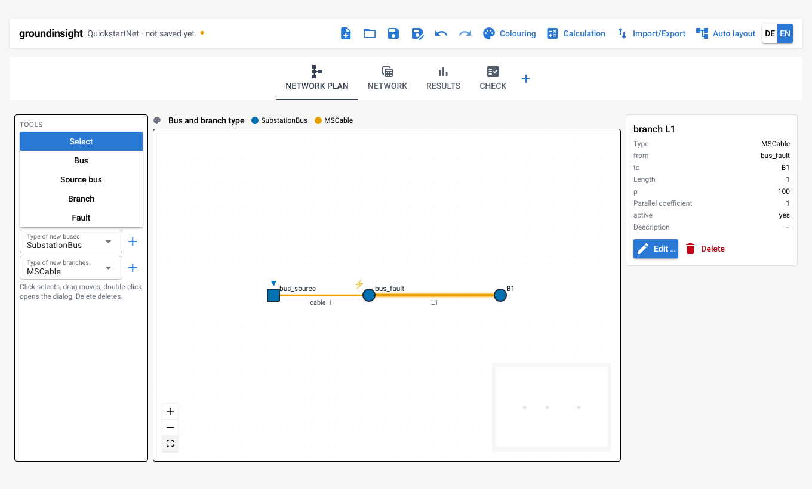
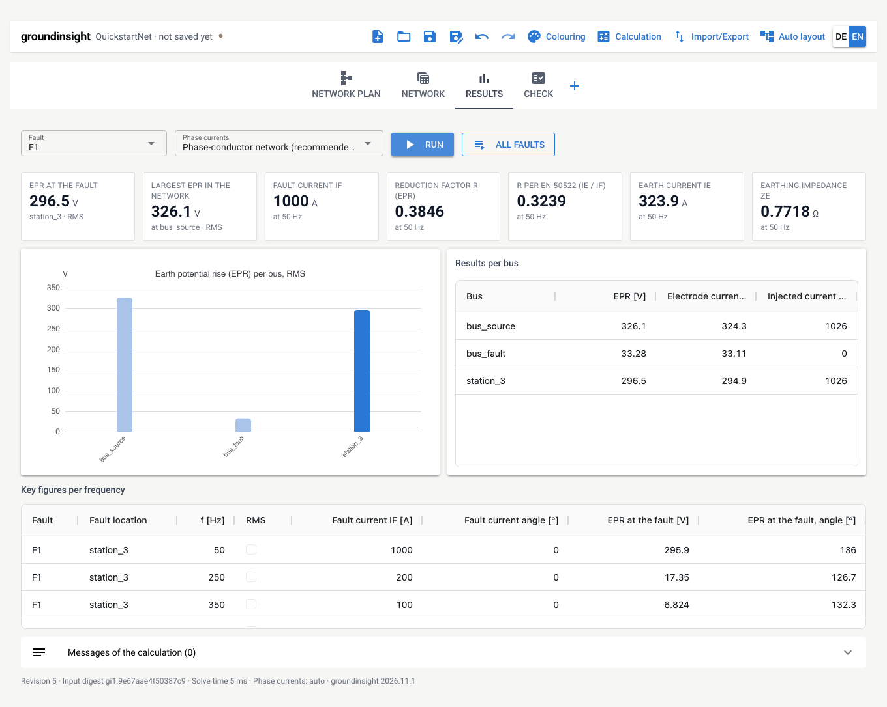

# Draw and solve a network

This tutorial uses `groundinsight-gui`, the front end of the library: you draw
a network on a canvas, solve a fault and read the results, without writing
code. It starts from the network of [Your first fault calculation](first-calculation.md)
— two substations and a 5 km cable — and adds a third station behind a 3 km
cable. At the end the same network is built with the library, and both give
the same numbers.

## Install and start

The GUI is a distribution of its own, `groundinsight-gui`, in the library's
repository. It is not on PyPI yet; install it together with the library from
a checkout, so that both have the same version:

```bash
git clone https://github.com/Ce1ectric/groundinsight.git
cd groundinsight
python -m venv .venv
source .venv/bin/activate      # Windows: .venv\Scripts\activate
pip install . ./gui
python -m groundinsight_gui --lang en
```

The last command opens `http://127.0.0.1:8080` in the browser
(`--native` opens a desktop window instead, after `pip install "./gui[native]"`;
`--help` lists all options). The server listens on your machine only.

## 1. Start from a template


Click **Quickstart**. The template is the network of the first tutorial:
`bus_source` with the infeed (the blue triangle), `bus_fault` with the fault
`fault_at_remote_bus` (the flash) and `cable_1` between them, at 50, 250, 350,
450 and 550 Hz. The *Network plan* tab shows it; *Network* holds the same
network as editable tables, and a change in one shows in the other.

## 2. Draw a station and a cable

In the **Tools** palette on the left:

1. Choose **Bus**, keep *Type of new buses* at `SubstationBus`, and click into
   the canvas to the right of `bus_fault`. A bus `B1` appears.
2. Choose **Branch**, keep *Type of new branches* at `MSCable`, and drag from
   `bus_fault` to `B1`. A 1 km cable `L1` connects them.
3. Choose **Select** again. A click selects an element and shows it in the
   *Properties* panel on the right; dragging moves a symbol on the raster.



Double-click `B1`. In the dialog, set *Name* to `station_3` and keep
ρ = 100 Ω·m; **Apply**. Double-click the cable `L1`, set *Name* to `cable_2`
and *Length / km* to `3`; **Apply**.


Every change is one step of the service layer: **Undo** and **Redo** in the
toolbar take it back and forth, and a change the library refuses — a
duplicate name, a negative length — is not applied and says why.

!!! tip "Other types"

    The **+** next to *Type of new buses* and *Type of new branches* adds a
    type from the [standard library](../reference/standard-types.md) — 20 kV
    cable systems, NAYY cables, typical earth electrodes — and makes it the
    type of new elements. The template **Empty project** starts without any
    element; the network tab's type tables create, edit and copy types.

## 3. Put a fault at the new station

Choose **Fault** and click `station_3`. The fault `F1` carries a scaling of
1 at every frequency, so the infeed's harmonics flow to it as well. (The
fault of the template scales 50 Hz only.)

## 4. Solve and read the results

**Calculation → Solve the fault** opens the *Results* tab. Choose `F1` under
*Fault* and press **Run**.



The tiles give the key figures of EN 50522 at the fault location: the earth
potential rise `U_E` = 296.5 V (RMS over the five frequencies), the earthing
impedance `Z_E` = 0.7718 Ω, the earth current `I_E` = 323.9 A and the
reduction factor `r` = 0.3239, the last three at 50 Hz. Below them are the EPR
of every bus, the key figures per frequency (`res_fault`) and the messages of
the calculation. The line at the bottom names the revision of the network and
its input digest: after an edit the result is marked stale until you run it
again.

Back in the *Network plan*, **Colouring → Result: EPR (RMS)** colours every
bus by its EPR; the fit button of the canvas (bottom left) shows the whole
network.


**Save as** writes the project file — network, plan and evaluation tabs in
one JSON file that the library reads with `gi.load_project`.

## 5. The same network with the library

The template is `groundinsight.api.examples.build_quickstart`, the network of
the first tutorial. The three steps of the drawing are three calls:

```python
import polars as pl

import groundinsight as gi
from groundinsight.api.examples import build_quickstart

net = build_quickstart()
station = net.buses["bus_fault"].type
cable = net.branches["cable_1"].type
gi.create_bus(name="station_3", type=station, specific_earth_resistance=100.0, network=net)
gi.create_branch(name="cable_2", type=cable, from_bus="bus_fault", to_bus="station_3",
                 length=3.0, specific_earth_resistance=100.0, network=net)
gi.create_fault(name="F1", bus="station_3", scalings={f: 1.0 for f in net.frequencies},
                network=net)
gi.run_fault(net, "F1")

key = net.res_fault("F1").row(0, named=True)  # 50 Hz
print(f"Z_E = {key['Z_E_Ohm']:.4f} Ohm, I_E = {key['I_E_A']:.1f} A, r = {key['r_current']:.4f}")
for name, epr in net.res_buses("F1").filter(pl.col("is_rms")).select("bus_name", "EPR_V").rows():
    print(f"{name:10s} {epr:6.1f} V")
```

```text title="Output"
Z_E = 0.7718 Ohm, I_E = 323.9 A, r = 0.3239
bus_source  326.1 V
bus_fault    33.3 V
station_3   296.5 V
```

The numbers are those of the GUI. The project file saved in step 4 gives them
too: `gi.load_project(path).network`, solved for `F1`, is this network.

## Where to go next

- The GUI covers the whole library. **Calculation** runs all faults, the
  pre-flight check, outage and rho-f studies, cuts, the bus response, the
  thermal and touch-voltage checks of EN 50522, transients and the reference
  cases; their tables are the library's frames.
- An earthing characteristic of a station — impedance, touch factor and
  transfer factor over ρ and f, typically from a field calculation — goes on
  the *Earthing characteristic* tab of the bus dialog
  ([how-to](../howto/groundfield-characteristics.md));
  [Touch voltage and transferred potential](../explanation/touch-and-transfer.md)
  explains what the GUI then colours by.
- [From a line to a ring](ring.md) continues with the library.
